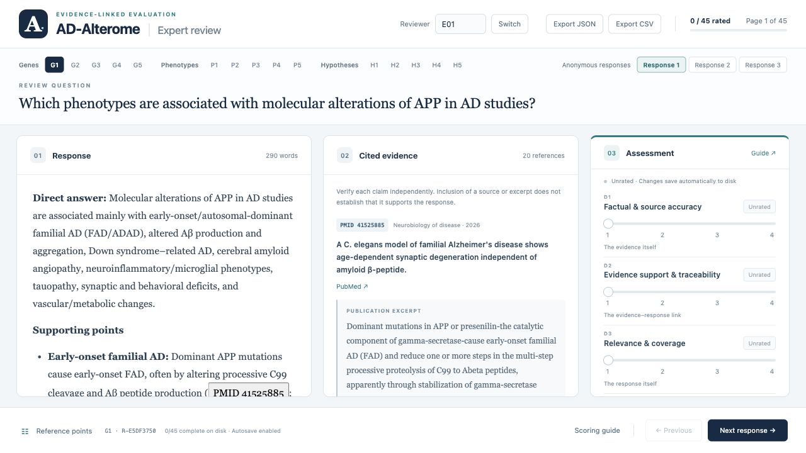

# AD-Alterome

This repository provides source materials for the AD-Alterome manuscript and the
LLM-assisted AD hypothesis annotation experiment, together with bilingual
expert-review interfaces for question-answering evaluation.

The sentence-annotation workflow is not direct event extraction. It starts from
literature-derived AD-Alterome candidate sentences and asks an LLM to evaluate
AD relevance, molecular-mechanism content, and links to predefined Alzheimer
disease hypotheses.

## Contents

- [`expert_review/`](expert_review/): English and Chinese expert-review systems,
  15 questions, 45 anonymous response pages, three anchored rating dimensions,
  cited evidence, and local saving/export instructions.
- [`expert_review/en/docs/`](expert_review/en/docs/): unscored interface
  screenshots and an English supplementary figure caption.
- `llm_hypothesis_annotation/raw_data/`: raw sentence datasets used for prompt
  refinement and model comparison.
- `llm_hypothesis_annotation/prompts/hypothesis-annotation-prompt.v2.txt`:
  active prompt for sentence-level AD hypothesis annotation.
- `llm_hypothesis_annotation/prompts/base-prompt.v4.*.txt`: legacy prompt
  drafts for direct genetic alteration regulatory event extraction, retained as
  historical materials but not the active hypothesis annotation prompt.
- `llm_hypothesis_annotation/manual_review/`: manually reviewed annotation
  check files with English filenames.
- `llm_hypothesis_annotation/README.md`: methodological notes, model settings,
  sampling rules, manual review notes, model access dates, and generative AI
  use statement.

## Expert Review Interface

Choose the [English interface](expert_review/en/) or the
[Chinese interface](expert_review/zh/). Download and extract this repository,
then run `sh start.sh` from the chosen language folder, or use its macOS or
Windows launcher. Python 3 is required; the review systems need no third-party
packages or model API keys.

Each response is assessed independently for factual and source accuracy,
evidence support and traceability, and relevance and coverage, using integer
scores from 1 to 4. A response panel, cited-source panel, and assessment panel
are shown together. Question-specific reference points and a scoring guide are
available in floating windows.

This release contains blank review interfaces and existing model responses;
it does not include collected reviewer scores or the private response-to-method
mapping. Reviewer IDs use neutral labels such as `E01`. The two language
versions present the same underlying responses; they are alternative interfaces,
not independent evaluation datasets. See the
[review-system README](expert_review/README.md) for the rating protocol,
storage modes, and screenshot assets.

## Active Annotation Task

The active prompt asks the model to annotate each source sentence with:

- whether the sentence is relevant to AD, or which other disease is explicitly
  mentioned;
- a sentence definition/explanation;
- whether a molecular mechanism is provided, with reasoning;
- linked AD hypotheses from the predefined hypothesis list;
- an extended explanation of how the hypothesis accounts for the described
  phenomenon;
- whether the hypothesis judgment is based completely on the sentence, partly
  on external resources, or completely on external resources;
- whether the judgment basis is gene-level, phenotype-level, or both.

The predefined hypothesis list contains 11 AD hypothesis classes plus
`Not applicable to any AD hypothesis`:

1. Cholinergic hypothesis
2. Amyloid hypothesis
3. Tau protein hypothesis
4. Neuroinflammation hypothesis
5. Oxidative stress hypothesis
6. Metal ion hypothesis
7. Glutamatergic excitotoxicity hypothesis
8. Microbiota-Gut-Brain Axis hypothesis
9. Abnormal autophagy hypothesis
10. Mitochondrial autophagy hypothesis
11. Vascular hypothesis
0. Not applicable to any AD hypothesis

## Citation

If you use these materials, please cite the AD-Alterome manuscript and this
repository.
